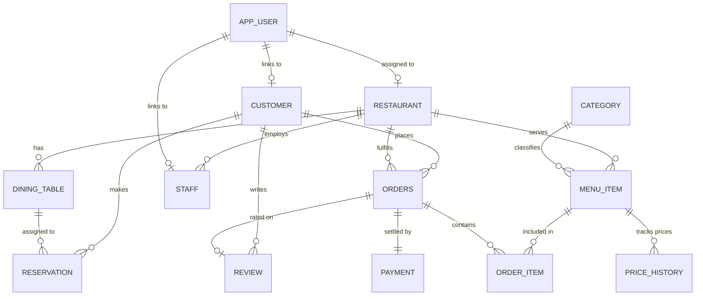

# 🧾 Receiptify · Restaurant Table Reservation & Food Ordering System (DA2)

[](https://www.oracle.com/database/)
[](https://python.org)
[](https://flask.palletsprojects.com/)
[](#-receiptify-design-system--paper-animations)
[](#)

> **Course:** Database Systems (`BACSE202`) &bull; **Digital Assignment 2 (DA2)**  
> **Team Members:**  
> - **Rohan Jena** (`25BCE5616`)  
> - **Rishav Singh** (`25BCE5224`)  
> - **Khyati Shreya** (`25BCE5605`)  

---

## 📋 Table of Contents
1. [Project Overview](#-project-overview)
2. [Receiptify Aesthetic & Paper Animations](#-receiptify-design-system--paper-animations)
3. [Quick Start Guide](#-quick-start-guide)
4. [Multi-Role Authentication & Demo Accounts](#-multi-role-authentication--demo-accounts)
5. [Relational Schema Architecture (BCNF)](#-relational-schema-architecture-bcnf)
6. [Business Rules & Oracle Enforcement (BR-1 to BR-12)](#-business-rules--enforcement-mechanisms)
7. [The 12 System Analytical Queries](#-the-12-system-analytical-queries)
8. [Live Evaluator Demo Walkthrough](#-live-evaluator-demo-walkthrough-5-minutes)
9. [Automated Test Suite](#-automated-testing--verification)
10. [Repository Directory Structure](#-repository-structure)
11. [Troubleshooting & FAQs](#-troubleshooting--faqs)

---

## 🌟 Project Overview

**Receiptify** is an enterprise-grade Restaurant Table Reservation & Food Ordering System engineered on a native Oracle relational database. The application unifies table reservations, dining floor management, menu catalogs, multi-stage kitchen orders, financial billing, and verified diner reviews into a high-performance database engine.

### Key Highlights
- **DBMS Backend:** Native Oracle Database 21c XE / 12c Enterprise running on `localhost:1521` with connection pooling via `python-oracledb` (thin mode).
- **Normalized Schema:** 12 tables structured strictly up to **Boyce-Codd Normal Form (BCNF)** with synthetic identity keys, primary & foreign key constraints, and check constraints.
- **Oracle Business Logic:** Stored procedures, PL/SQL functions, function-based unique indexes, explicit cursors, dynamic `SYS_REFCURSOR`, and a **Compound Trigger** solving the classic mutating-table (`ORA-04091`) challenge.
- **Receiptify Frontend:** Unique, tactile "Receiptify" aesthetic inspired by thermal-printed POS receipts, perforated tickets, rubber ink stamps, scannable barcodes, and paper rollout animations.
- **Multi-Role RBAC:** Role-Based Access Control partitioning features for **Customers**, **Front Desk Staff**, and **Executive Owners**.
- **12 Analytical Queries:** Pre-built, interactive query suite with parameter filters and live Oracle buffer streaming (`DBMS_OUTPUT`).

---

## 🧾 Receiptify Design System & Paper Animations

The application features a custom-built **Receiptify** visual theme designed to feel like an authentic, bustling restaurant cash register station:

| Aesthetic Element | Description | Implementation |
|---|---|---|
| **Thermal Receipt Paper** | Off-white warm paper tone (`#fffef9`) with subtle fiber textures and realistic multi-layered drop shadows. | Custom CSS variables & box-shadows |
| **Sawtooth / Perforated Edges** | Authentic jagged saw-tooth top and bottom tear lines on all cards, order chits, and modals. | CSS repeating linear gradients |
| **Rubber Ink Stamps** | Stamped status badges (`[PAID]`, `[CONFIRMED]`, `[PREPARING]`, `[SERVED]`, `[CANCELLED]`) rotated with realistic ink borders. | CSS keyframe stamp slam animation |
| **Paper Rollout Animation** | Slips and receipts smoothly roll down out of the printer feed slot when pages load. | `@keyframes thermalPrintRoll` |
| **3D Tactile Paper Curl** | Hovering over receipts and tables causes slips to lift and tilt in 3D perspective with realistic shadows. | CSS 3D transforms & JavaScript pointer tracking |
| **Scannable Barcodes** | Every receipt slip and pass features an authentic scannable thermal barcode graphic with order reference IDs. | CSS repeating gradients & monospace tags |
| **Physical Printing Support** | 1-Click "Print Thermal Receipt" button with print media queries (`@media print`) formatted for standard 80mm POS paper rolls. | JavaScript `window.print()` & print CSS |

---

## 🚀 Quick Start Guide

### Prerequisites
1. **Oracle Database:** Oracle 21c XE, 12c, or Oracle Free installed on Windows (`localhost:1521`).
2. **Python:** Version 3.10 or higher.
3. **SQL\*Plus:** Available in your system PATH (e.g. from Oracle client or database home).

---

### Step 1: Install Dependencies
Open your terminal in the project root directory and run:
```bash
pip install -r requirements.txt
```

---

### Step 2: Configure Environment Variables
Copy `.env.example` to `.env` or create `.env` in the repository root:
```env
# Oracle Database Connection Configuration
ORACLE_USER=restaurant_app
ORACLE_PASSWORD=restaurant_pass
ORACLE_HOST=localhost
ORACLE_PORT=1521
ORACLE_SERVICE=orclpdb      # Use XEPDB1 for Oracle 21c XE, or orclpdb for Oracle 12c

# Flask Configuration
FLASK_APP=app/app.py
FLASK_ENV=development
FLASK_DEBUG=1
SECRET_KEY=restaurant_db_secret_key_2026_bacse202
```

> [!TIP]
> If using **Oracle 12c**, the default PDB service name is usually `orclpdb`. If using **Oracle 21c XE**, it is usually `XEPDB1`.

---

### Step 3: Database Setup & Population (One-Click)

Run the automated setup batch script:
```cmd
run_setup.bat
```

**Or execute step-by-step manually:**
```bash
# 1. Create schema & tables
sqlplus restaurant_app/restaurant_pass@localhost:1521/orclpdb @database_scripts/01_schema.sql

# 2. Compile PL/SQL procedures, functions & compound triggers
sqlplus restaurant_app/restaurant_pass@localhost:1521/orclpdb @database_scripts/03_plsql.sql

# 3. Seed realistic sample culinary data (300+ records)
sqlplus restaurant_app/restaurant_pass@localhost:1521/orclpdb @database_scripts/02_data.sql

# 4. Seed multi-role authentication accounts
python setup_auth.py

# 5. Run the automated 15-test verification suite
sqlplus restaurant_app/restaurant_pass@localhost:1521/orclpdb @database_scripts/05_tests.sql
```

---

### Step 4: Launch Web Application
Start the Flask web server:
```cmd
run_app.bat
```
*Or directly via Python:*
```bash
python app/app.py
```

Open your browser and navigate to:  
👉 **[http://localhost:5000](http://localhost:5000)**

---

## 🔑 Multi-Role Authentication & Demo Accounts

Receiptify features full **Role-Based Access Control (RBAC)**. The login screen includes **1-click preset buttons** to instantly sign in as any role:

| Role | Account Email | Password | Permissions & Primary Interface |
|---|---|---|---|
| **🍽️ Customer** | `customer@example.com` | `customer123` | **Personal Dining Hub:** Book tables for self, order food, view personal running totals, settle payments, submit verified reviews. |
| **📋 Staff (Receptionist)** | `receptionist@example.com` | `staff123` | **Front Desk Operations:** Seat arriving guests, live table occupancy tracking, advance kitchen order workflow (`PLACED -> PREPARING -> READY -> SERVED`). |
| **👑 Owner** | `owner@example.com` | `owner123` | **Executive Overview:** Multi-branch oversight, customer management, catalog pricing (`sp_set_price`), and all 12 analytical SQL/PL-SQL reports. |

### Feature & URL Permission Matrix

| Feature / URL | Guest | Customer | Staff (Receptionist) | Owner |
|---|:---:|:---:|:---:|:---:|
| **Landing Portal (`/`)** | Public Info | Personal Dining Hub | Front Desk & Kitchen | Executive Ledger |
| **Registration (`/register`)** | ✅ Open | ✅ Open | ✅ Open | ✅ Open |
| **Login / Logout (`/login`, `/logout`)** | ✅ Open | ✅ Open | ✅ Open | ✅ Open |
| **User Profile Slip (`/profile`)** | ❌ (Redirects) | ✅ Personal Details | ✅ Staff Assignment | ✅ Executive Details |
| **Table Reservations (`/reservations`)** | ❌ (Redirects) | View/Book Own | View/Manage Branch | Full Management |
| **Order Receipts & Billing (`/orders`)** | ❌ (Redirects) | View/Order Own | Manage Kitchen/Bill | Full Management |
| **Menu Catalog (`/menu`)** | ❌ (Redirects) | View Menu Only | View Menu Only | ✅ Add/Edit & Set Price |
| **Customer Directory (`/customers`)** | ❌ (Denied) | ❌ (Access Denied) | ❌ (Access Denied) | ✅ Full CRUD |
| **12 Analytical Reports (`/reports`)** | ❌ (Denied) | ❌ (Access Denied) | ❌ (Access Denied) | ✅ Full Access |

---

## 📊 Relational Schema Architecture (BCNF)

All 12 tables use synthetic identity primary keys (`NUMBER GENERATED ALWAYS AS IDENTITY`) and are normalized up to **BCNF** to eliminate redundancy and update anomalies.



### Table Breakdown by Domain

#### 🏢 Dining Floor & Personnel
- `RESTAURANT`: Branch locations, cuisine classification, contact numbers, and operating hours.
- `DINING_TABLE`: Table numbers (`UNIQUE` per restaurant), guest seating capacities, and active status.
- `STAFF`: Restaurant personnel roster (Head Chef, General Manager, Waiter, Receptionist).
- `RESERVATION`: Bookings with party sizes, dates, time slots, and status (`BOOKED`, `CONFIRMED`, `CANCELLED`, `COMPLETED`).

#### 🍛 Menu Catalog & Audit Pricing
- `CATEGORY`: Dish classifications (Starters, Main Course, Biryani, Breads, Desserts, Beverages).
- `MENU_ITEM`: Dish names, descriptions, dietary flags (`VEG` / `NON-VEG`), and prep times.
- `PRICE_HISTORY`: Historical price audit trail. Exactly one active price record exists per item (`end_date IS NULL`).

#### 💳 Orders & Financial Billing
- `ORDERS`: Order headers with dining workflow status and running total automatically maintained by compound triggers.
- `ORDER_ITEM`: Dish line items and quantities (`UNIQUE(order_id, item_id)`).
- `PAYMENT`: Succeeded financial settlement (`1:1` with order), payment method (`UPI`, `CARD`, `CASH`, `COUPON`).

#### 🛡️ Identity & Feedback
- `CUSTOMER`: Registered diners, verified emails (`UNIQUE`), and residential addresses.
- `REVIEW`: Verified dining reviews (1 to 5 stars) permitted only on completed, paid orders.
- `APP_USER`: Multi-role credentials store (`email UNIQUE`, Werkzeug scrypt `password_hash`, role checks).

---

## ⚖️ Business Rules & Enforcement Mechanisms

| Rule ID | Business Constraint | Enforcement Mechanism |
|---|---|---|
| **BR-1** | No double-booking for the same table, date, and time slot | Function-based unique index `uq_res_active_slot` on non-cancelled rows & procedure `sp_make_reservation` |
| **BR-2** | Guest party count must not exceed table seating capacity | Row trigger `trg_reservation_guest_check` & procedure `sp_make_reservation` |
| **BR-3** | Reservation booking date cannot be in the past | Procedural validation in `sp_make_reservation` |
| **BR-4** | Dish ordered must belong to the order's designated restaurant branch | Validation check in procedure `sp_add_order_item` |
| **BR-5** | Unique dish per line item; re-adding increments quantity | `UNIQUE(order_id, item_id)` constraint & procedure `sp_add_order_item` |
| **BR-6** | Line item price matches price active on order date | Deterministic PL/SQL function `fn_price_on(item_id, order_date)` |
| **BR-7** | Order running total equals sum of line items | **Compound trigger `trg_order_item_total`** (eliminates mutating-table `ORA-04091`) |
| **BR-8** | Order status strictly advances forward | Procedure `sp_update_order_status` (`PLACED -> PREPARING -> READY -> SERVED -> DELIVERED`) |
| **BR-9** | Exactly one payment per order, matching exact total | `UNIQUE(order_id)` constraint & trigger `trg_payment_validate` |
| **BR-10**| Reviews require completed/served order and settled payment | Row trigger `trg_review_validate` |
| **BR-11**| Unique diner and account email addresses | `UNIQUE(email)` constraint on `CUSTOMER` and `APP_USER` |
| **BR-12**| At most one open price period per menu item | Function-based unique index `uq_item_active_price` & procedure `sp_set_price` |

---

## 📈 The 12 System Analytical Queries

The application includes an executive reporting console (`/reports`) executing all 12 system queries live against the Oracle engine:

| # | Business Question | DBMS Technique & Implementation |
|:---:|---|---|
| **1** | Free dining tables satisfying party size for restaurant, date, and slot | Correlated `NOT EXISTS` subquery against active reservations |
| **2** | Top 5 best-selling dishes across all restaurants by quantity sold | Multi-table `JOIN`, `GROUP BY`, `SUM`, `FETCH FIRST 5 ROWS ONLY` |
| **3** | Monthly revenue per restaurant from settled (`SUCCESS`) payments | `GROUP BY` with `TO_CHAR(payment_date, 'YYYY-MM')`, `SUM` |
| **4** | Repeat loyal customers with > 2 orders and aggregate spend | `GROUP BY` with `HAVING COUNT(order_id) > 2`, `SUM` |
| **5** | Average diner satisfaction rating and review counts per restaurant | `LEFT OUTER JOIN`, `NVL`, `ROUND`, `AVG`, `COUNT` |
| **6** | Active dish price and number of historical price revisions | `PRICE_HISTORY` with `end_date IS NULL` & scalar subquery |
| **7** | Customers who reserved a table but never placed an order | Correlated `NOT EXISTS` against `ORDERS` with `EXISTS` on `RESERVATION` |
| **8** | Unpaid or pending orders requiring financial audit reconciliation | Querying database view `v_order_summary` with `NULL`/status filter |
| **9** | Catalog menu items that have never been ordered | `NOT EXISTS` subquery against `ORDER_ITEM` |
| **10**| Premier, most expensive menu item at each restaurant branch | Analytic window function `RANK() OVER (PARTITION BY restaurant_id ORDER BY price DESC)` |
| **11**| Daily executive sales & performance summary | **PL/SQL Procedure `sp_daily_sales_report`** using explicit cursor & `DBMS_OUTPUT` |
| **12**| Customer spend analytics with dynamic threshold filter | **PL/SQL Procedure `sp_customer_spend_report`** returning `SYS_REFCURSOR` |

---

## 🎯 Live Evaluator Demo Walkthrough (5 Minutes)

Follow this structured path to experience all system capabilities:

1. **Receiptify Landing Page (`/`):**
   - Observe the thermal receipt master banner, role ticket cards, and live Oracle table record counts.
2. **One-Click Demo Sign-In (`/login`):**
   - Click the **🍽️ Diner / Customer** button and sign in.
3. **Table Booking Voucher Desk (`/reservations`):**
   - Click **Issue Table Voucher**. Select restaurant, date, and party size.
   - Observe the live availability checker query available tables dynamically.
   - Click **Void** on any booking to execute `sp_cancel_reservation` and free the slot.
4. **Thermal Receipt Ordering (`/orders` & `/orders/<id>`):**
   - Create a new order slip. On the detail screen, add food dishes.
   - Watch the **running total** update instantly via Oracle compound trigger `trg_order_item_total`.
   - Advance the kitchen stage (`PLACED -> PREPARING -> READY -> SERVED`).
   - Settle payment with exact amount matching verified by `trg_payment_validate`.
   - Click **Print Thermal Receipt** to view the print-ready 80mm slip.
5. **Diner Reviews (`/reviews`):**
   - Submit a verified review for the completed order with a 5-star rating stamp.
6. **Executive Owner Switch:**
   - Sign out and click **👑 Restaurant Owner** on `/login`.
7. **Menu Price Revisions (`/menu`):**
   - Click **Price** on any dish to execute `sp_set_price`. Enter a new price.
   - Click **Revisions** to inspect the chronological `PRICE_HISTORY` modal.
8. **Register Tape Audit Console (`/reports`):**
   - Browse and execute queries 1 through 10.
   - Test **Query 11** to view real-time captured `DBMS_OUTPUT` from `sp_daily_sales_report`.
   - Test **Query 12** to stream a dynamic `SYS_REFCURSOR` spend breakdown.

---

## 🧪 Automated Testing & Verification

The repository includes a comprehensive SQL\*Plus automated test suite (`05_tests.sql`) verifying all constraints:

```text
============================================================================
DA2 TEST SUITE SUMMARY: 15 / 15 TESTS PASSED
============================================================================
TEST-01: Table reservation created successfully                    -> PASS
TEST-02: Double-booking rejected by unique index                   -> PASS
TEST-03: Guest count exceeding capacity rejected                   -> PASS
TEST-04: Order created successfully                                -> PASS
TEST-05: Line item added and unit price captured                   -> PASS
TEST-06: Duplicate dish increments quantity                        -> PASS
TEST-07: Running total updated by compound trigger                 -> PASS
TEST-08: Cross-restaurant dish ordering rejected                   -> PASS
TEST-09: Order status workflow validated                           -> PASS
TEST-10: Payment matching exact total accepted                     -> PASS
TEST-11: Mismatched payment rejected                               -> PASS
TEST-12: Duplicate payment on settled order rejected               -> PASS
TEST-13: Verified review accepted                                  -> PASS
TEST-14: Review on unpaid order rejected                           -> PASS
TEST-15: sp_set_price closes previous price and creates new record -> PASS
```

---

## 📁 Repository Structure

```text
DBMS_RESTAURANT_MANAGER/
├── app/                        # Web Application Module
│   ├── app.py                  # Flask routes, authentication, RBAC & API endpoints
│   ├── db.py                   # python-oracledb connection pool & query layer
│   ├── static/
│   │   ├── css/
│   │   │   └── style.css       # Receiptify design system & paper animation engine
│   │   └── js/
│   │       └── main.js         # Client-side paper sound synth, 3D tilt & modals
│   └── templates/              # Thermal receipt HTML templates
│       ├── base.html           # Cash register POS header & tape footer
│       ├── index.html          # Public landing terminal
│       ├── index_customer.html # Customer personal dining hub
│       ├── index_staff.html    # Front desk arrivals & kitchen ticket rail
│       ├── index_owner.html    # Executive Z-Report ledger
│       ├── login.html          # POS authentication slip with 1-click presets
│       ├── register.html       # Diner / staff credential issuance slip
│       ├── menu.html           # Menu catalog chits & price history
│       ├── reservations.html   # Table booking vouchers & availability
│       ├── orders.html         # Register journal of active order slips
│       ├── order_detail.html   # Full thermal restaurant receipt slip
│       ├── customers.html      # Diner directory ledger
│       ├── reports.html        # 12 analytical query register tape
│       ├── reviews.html        # Verified feedback slips
│       └── profile.html        # Staff badge & diner credential pass
├── database_scripts/           # Native Oracle SQL & PL/SQL Scripts
│   ├── 01_schema.sql           # DDL: 12 BCNF tables, constraints & indexes
│   ├── 02_data.sql             # Realistic Indian culinary dataset (300+ records)
│   ├── 03_plsql.sql            # Procedures, functions & compound trigger
│   ├── 04_queries.sql          # Standalone SQL queries for all 12 reports
│   ├── 05_tests.sql            # Automated SQL*Plus 15-test verification suite
│   └── 06_auth_schema.sql      # DDL: Multi-role authentication table (APP_USER)
├── tests/                      # Automated Python Test Suites
│   ├── test_auth_roles.py      # RBAC permission boundary tests
│   └── test_e2e.py             # Full browser integration test suite
├── .env                        # Local database connection credentials
├── .env.example                # Template configuration file
├── requirements.txt            # Python dependencies
├── run_app.bat                 # 1-Click web application launcher
├── run_setup.bat               # 1-Click database setup script
├── setup_auth.py               # Authentication account seeder script
└── README.md                   # Complete project documentation
```

---

## 🛠️ Troubleshooting & FAQs

### Q: Oracle connection error: `ORA-12514: TNS:listener does not currently know of service requested`
**Fix:** Verify your Oracle Pluggable Database (PDB) service name in `.env`.
- For Oracle 21c XE, the service name is typically `XEPDB1`.
- For Oracle 12c, it is typically `orclpdb`.
You can check active services by running `lsnrctl status` in PowerShell.

### Q: `ModuleNotFoundError: No module named 'flask'`
**Fix:** Run `pip install -r requirements.txt` to install all dependencies.

### Q: How do I change between light and dark modes?
**Fix:** The **Receiptify** theme uses a high-contrast dark slate countertop background (`#111215`) that makes thermal receipt paper slips (`#fffef9`) pop with realistic paper drop shadows and 3D tilt.

---

<div align="center">
  <b>Designed for Database Systems (BACSE202) Digital Assignment 2</b><br>
  <i>Built with Oracle Database 21c/12c XE, Python 3, Flask, and the Receiptify Design System</i>
</div>
